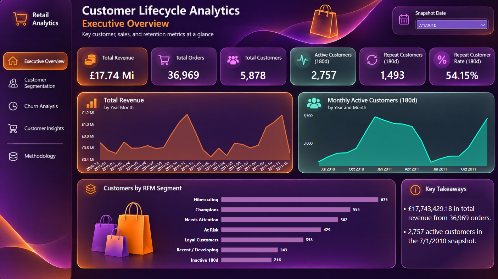
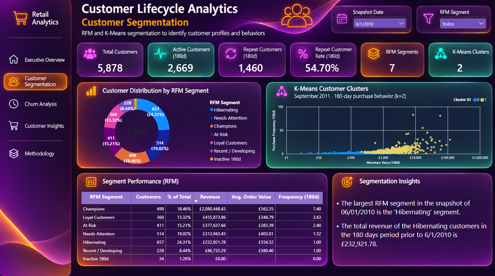
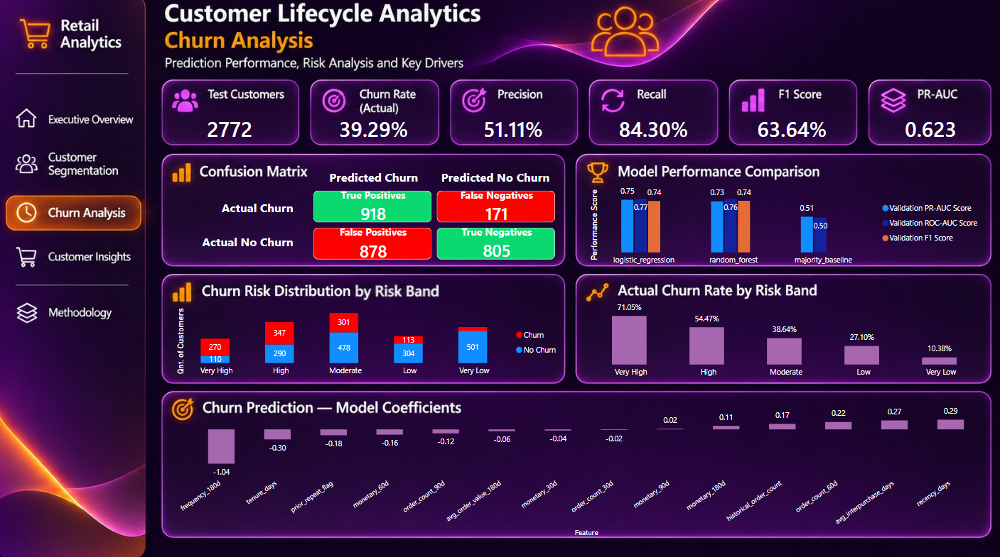
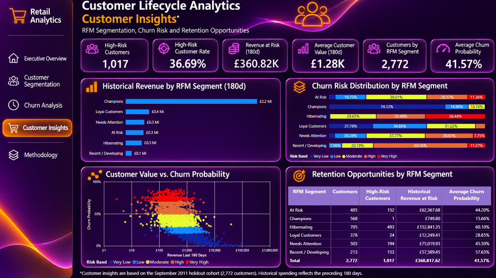
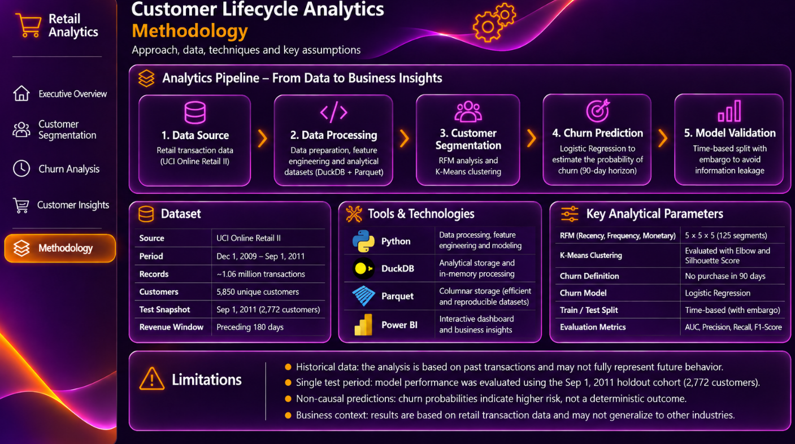
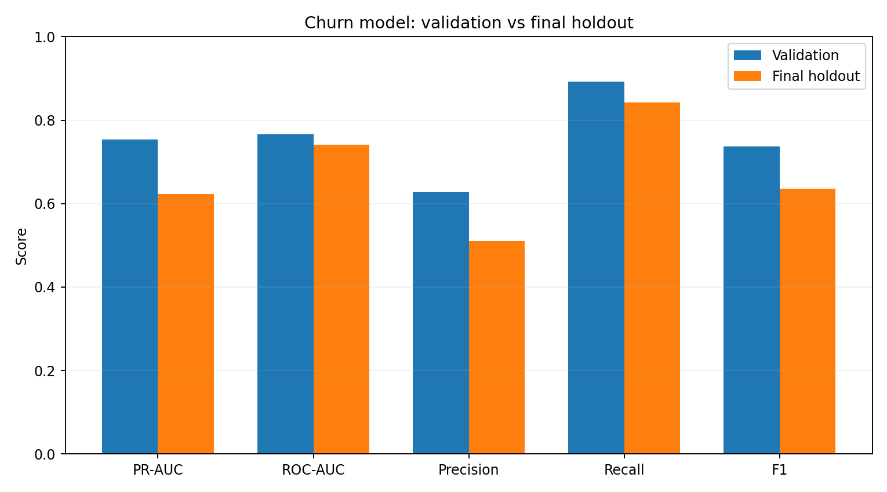
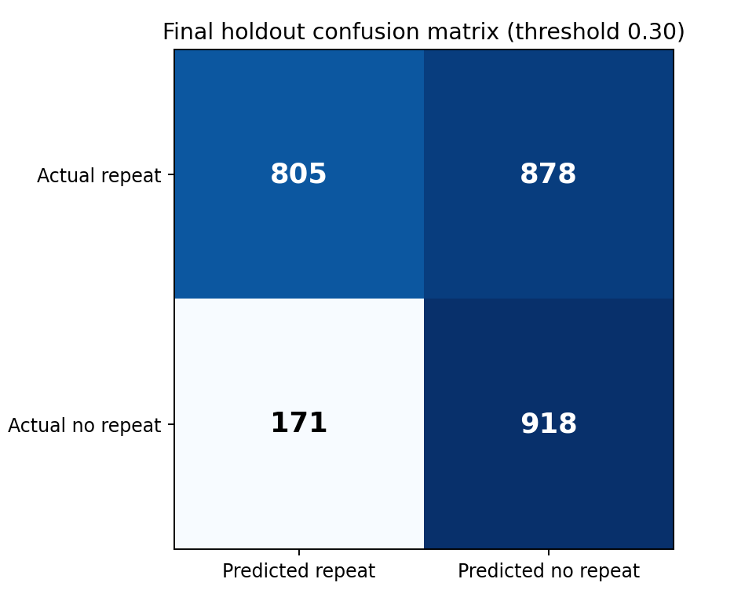

# Customer Lifecycle Analytics — RFM, K-Means & Churn Prediction

End-to-end customer analytics and machine learning portfolio project using the **UCI Online Retail II** transaction dataset to analyze purchasing behavior, customer segmentation, and 90-day non-repurchase risk.

**Tech Stack:** Python | SQL | DuckDB | Parquet | scikit-learn | Power BI

## Interactive Power BI Dashboard

**[View the Live Power BI Dashboard](https://app.powerbi.com/view?r=eyJrIjoiY2EwYmQ5NTAtNGNhZC00MjdlLWI4MTMtMTU4MjBkNDBiOGUxIiwidCI6ImJiZTBmNmVjLTZjNGQtNGMxMi05YjdkLWUyYTEzNWE2Yjk5NSJ9)**

Explore the complete analytical workflow through five interactive dashboard pages:

1. **Executive Overview** — Revenue performance, customer activity, repeat purchasing, and lifecycle indicators.
2. **Customer Segmentation** — RFM analysis, customer segments, and exploratory K-Means clustering.
3. **Churn Analysis** — Predictive model performance, confusion matrix, churn risk distribution, and logistic regression coefficients.
4. **Customer Insights** — Customer value, historical revenue at risk, and retention prioritization opportunities.
5. **Methodology** — Data sources, analytical techniques, modeling decisions, validation methodology, and limitations.

The dashboard provides an accessible presentation of the project's business insights and predictive analytics results.

### Dashboard Preview











The original Power BI Desktop report is available at `dashboard/Customer_Lifecycle_Analytics.pbix`, if included in the repository.

## Project Objectives

This project demonstrates an end-to-end customer analytics workflow, from raw transactional data to interactive business intelligence reporting.

The primary objectives are to:

- Build a reproducible analytical pipeline using Python, SQL, DuckDB, and Parquet.
- Transform transactional records into customer-level behavioral features.
- Analyze customer purchasing patterns through RFM segmentation.
- Explore customer groups using K-Means clustering.
- Develop a supervised model to estimate 90-day non-repurchase probability.
- Evaluate predictive performance using chronological data splits.
- Identify customer segments that may warrant retention-focused investigation.
- Communicate analytical findings through an interactive Power BI dashboard.

## Results at a Glance

| Stage | Result |
|---|---|
| Cleaned transactional data | 36,969 invoices; 5,878 customers |
| Historical customer features | 84,070 customer-snapshot observations; 8 reconciliation checks passed |
| RFM segmentation | 57,648 active and 26,422 inactive customer-snapshot observations |
| Exploratory K-Means | k=2 achieved the highest silhouette score among k=2–8 across Sep 2010, Mar 2011, and Sep 2011 |
| Supervised target | No valid purchase in the next 90 days |
| Eligible modeling population | Customers with at least one valid purchase in the preceding 180 days |
| Selected model | Logistic Regression, selected by validation PR-AUC |
| Frozen decision threshold | 0.30, selected by validation F1 |
| Final out-of-time holdout | September 2011; 2,772 customers |
| Final holdout non-repurchase rate | 39.29% |
| Final PR-AUC | **0.623** |
| Final ROC-AUC | **0.741** |
| Final precision | **51.11%** |
| Final recall | **84.30%** |
| Final F1-score | **63.64%** |



## Analytical Workflow

### 1. Data Ingestion and Preparation

The project uses the historical **UCI Online Retail II** dataset, containing retail transactions from 2009 to 2011.

The data pipeline performs transactional cleaning, validation, and preparation for downstream analytics.

DuckDB provides the analytical processing layer, while Parquet stores intermediate and final datasets.

### 2. Customer Feature Engineering

Historical customer-level features are generated across monthly snapshots.

These features summarize purchasing behavior, including:

- Recency of purchasing activity.
- Purchase frequency.
- Historical monetary value.
- Customer tenure.
- Interpurchase behavior.

Features are calculated using historical information available at each snapshot date.

### 3. RFM Customer Segmentation

RFM analysis evaluates customer behavior using three dimensions:

- **Recency:** How recently a customer purchased.
- **Frequency:** How frequently a customer purchased.
- **Monetary:** How much a customer spent.

The resulting segments support customer lifecycle analysis and comparisons of purchasing behavior.

RFM reporting also retains customers classified as inactive.

### 4. Exploratory K-Means Clustering

K-Means clustering is evaluated as a complementary segmentation technique.

Candidate cluster counts from k=2 to k=8 are compared using clustering quality metrics, including silhouette scores.

The exploratory analysis identifies k=2 as the strongest candidate among the evaluated configurations.

K-Means is presented as an analytical exploration rather than a validated commercial customer segmentation strategy.

### 5. Churn Prediction

The supervised learning task estimates the probability that an eligible customer will make **no valid purchase during the following 90 days**.

The target is defined as:

`churn_90d = 1`

when no valid purchase occurs during the interval:

`[snapshot date, snapshot date + 90 days)`

This represents an observable non-repurchase outcome, **not a permanent customer-loss diagnosis**.

The supervised model includes only customers with at least one valid purchase during the preceding 180 days.

The selected model is Logistic Regression, with preprocessing performed through a scikit-learn pipeline.

### 6. Model Validation

Chronological train, validation, and test periods are used to evaluate the model.

| Split | Snapshot months | Rows | No-repeat rate |
|---|---|---:|---:|
| Train | Jun 2010–Jan 2011 | 24,092 | 50.36% |
| Validation | May–Jun 2011 | 5,708 | 51.09% |
| Final holdout | Sep 2011 | 2,772 | 39.29% |

Outcome-window embargoes prevent direct overlap between split label windows.

A customer can appear in multiple historical snapshots, meaning observations are not necessarily independent.

Model selection was based on validation PR-AUC, and the classification threshold of 0.30 was selected using validation F1.

Both decisions were frozen **before evaluating the final holdout**.

### 7. Business Intelligence and Customer Insights

The final analytical outputs are integrated into Power BI to communicate customer behavior and predictive modeling results.

The dashboard combines:

- Revenue and purchasing performance.
- Customer lifecycle segmentation.
- Churn probability and risk bands.
- Predictive model evaluation.
- Historical customer value.
- Retention prioritization opportunities.

**Historical revenue at risk** represents prior 180-day spending associated with customers classified as high risk. It does not represent forecast revenue loss or the expected financial impact of churn.

## Model Performance

The final out-of-time evaluation was performed on the September 2011 holdout cohort of 2,772 customers.

| Metric | Final Holdout |
|---|---:|
| PR-AUC | 0.623 |
| ROC-AUC | 0.741 |
| Precision | 51.11% |
| Recall | 84.30% |
| F1-score | 63.64% |
| True Negatives | 805 |
| False Positives | 878 |
| False Negatives | 171 |
| True Positives | 918 |

The selected threshold emphasizes recall, identifying a substantial proportion of customers who subsequently make no purchase within the 90-day horizon.

However, this comes with a significant number of false positives.



## Reproduce the Pipeline

### Prerequisites

- Python and pip.
- Windows PowerShell for the commands below.
- The UCI Online Retail II source dataset.

Download the original dataset separately, following the instructions in `data/README.md`.

### 1. Create a Python Environment

```powershell
py -m venv .venv
.\.venv\Scripts\Activate.ps1
python -m pip install -r requirements.txt
```

### 2. Build Transactional and Customer Features

```powershell
python scripts/build.py --source "C:\path\to\online_retail_II.xlsx" --output output
```

### 3. Build RFM Segmentation

```powershell
python scripts/build_rfm.py --features output/customer_features.parquet --output output
```

### 4. Build the Churn Target

```powershell
python scripts/build_churn_target.py --orders output/orders_clean.parquet --features output/customer_features.parquet --output output/phase3_target
```

### 5. Prepare Chronological Splits

```powershell
python scripts/prepare_temporal_splits.py --features output/customer_features.parquet --labels output/phase3_target/churn_labels_90d.parquet --output output/phase3_splits
```

### 6. Train and Select the Model

```powershell
python scripts/train_churn_models.py --train output/phase3_splits/train.parquet --validation output/phase3_splits/validation.parquet --output output/phase3_models
```

### 7. Evaluate the Final Holdout

```powershell
python scripts/evaluate_churn_test.py --test output/phase3_splits/test.parquet --model output/phase3_models
```

**Important:** The final holdout evaluation is provided for reproducibility only. Its results must not be used to retune the classification threshold or reselect the model.

Generated datasets and model binaries are excluded from Git.

## Project Documentation

Additional technical documentation and analytical outputs are available below:

- [Model Evaluation and Limitations](docs/model_evaluation.md)
- [Logistic Regression Interpretation](docs/model_interpretation.md)
- [Methodology](docs/methodology.md)
- [Logistic Regression Coefficients](reports/logistic_regression_coefficients.csv)
- [Dashboard Documentation](dashboard/README.md)
- [Dataset Instructions](data/README.md)

## Limitations

This project is based on historical observational retail data collected between 2009 and 2011.

Important limitations include:

- **Historical data:** Purchasing behavior may differ substantially from current retail conditions.
- **Single-month holdout:** Final predictive performance was evaluated using one out-of-time test snapshot.
- **Prevalence sensitivity:** PR-AUC depends on the proportion of positive outcomes, which differs between validation and test periods.
- **False positives:** The recall-oriented classification threshold produces a substantial number of false-positive predictions.
- **Repeated customers:** Customers can appear in multiple historical snapshots, so observations are not fully independent.
- **Non-causal interpretation:** Logistic regression coefficients describe predictive associations, not causal relationships.
- **Business impact:** No retention uplift, campaign effectiveness, incremental profitability, or production deployment has been established.

The project is intended to demonstrate analytical engineering, customer segmentation, predictive modeling, and business intelligence capabilities rather than a production-ready retention system.

## Tools and Technologies

| Technology | Purpose |
|---|---|
| Python | Data processing, feature engineering, and modeling |
| SQL | Analytical queries and transformations |
| DuckDB | Analytical storage and query execution |
| Parquet | Efficient columnar data storage |
| pandas | Data preparation and analysis |
| scikit-learn | K-Means clustering, preprocessing, and Logistic Regression |
| Power BI | Interactive visualization and business reporting |
| Git / GitHub | Version control and portfolio distribution |

## Data Source

**UCI Machine Learning Repository — Online Retail II**

The original dataset is not bundled with the repository. Refer to `data/README.md` for source and download instructions.

## Project Status

**Completed — Analytical Pipeline, Customer Segmentation, Churn Prediction, Model Evaluation, and Power BI Dashboard.**

The interactive Power BI report is publicly available for portfolio review.

This project demonstrates an end-to-end workflow connecting data preparation, analytical modeling, model evaluation, and business intelligence reporting.