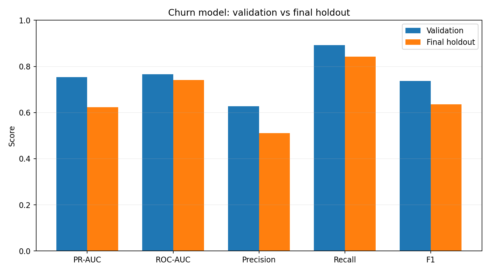
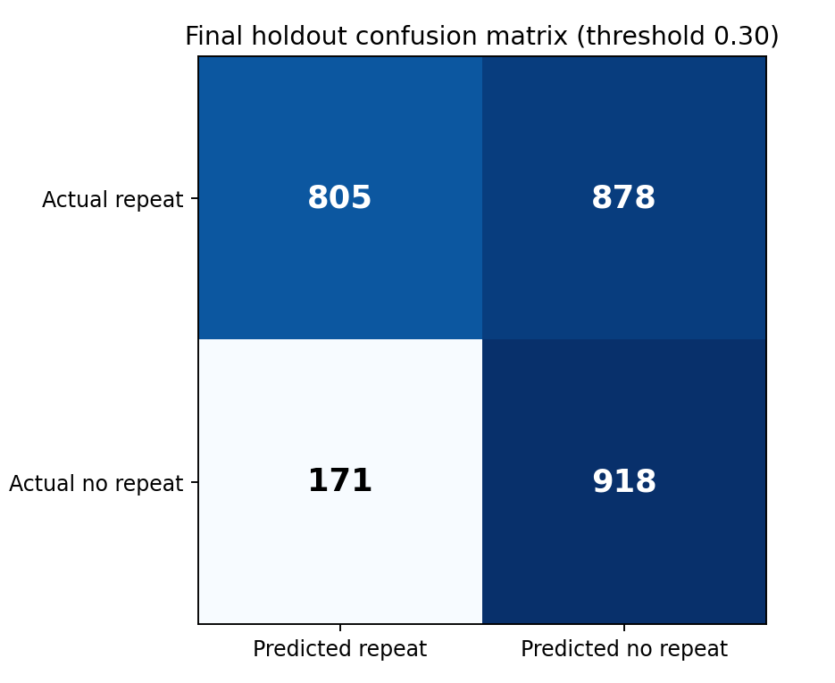

# Customer Lifecycle Analytics — RFM, K-Means & Churn Prediction

End-to-end portfolio project using the **UCI Online Retail II** transaction dataset to examine repeat purchasing, lifecycle segments and 90-day non-repurchase risk. Stack: Python, DuckDB, Parquet, SQL, scikit-learn. **Power BI dashboard: planned, not yet published.**

## Results at a glance

| Stage | Result |
|---|---|
| Cleaned transactional data | 36,969 invoices; 5,878 customers |
| Historical customer features | 84,070 customer-snapshot observations; 8 reconciliation checks passed |
| RFM | 57,648 active and 26,422 inactive customer-snapshot observations |
| Exploratory K-Means | k=2 highest silhouette among k=2–8 across Sep 2010, Mar 2011 and Sep 2011 |
| Supervised target | No valid purchase in the next 90 days; active customers have a purchase in prior 180 days |
| Selected model | Logistic Regression, selected by validation PR-AUC |
| Frozen decision threshold | 0.30, selected by validation F1 |
| Final out-of-time holdout | September 2011; 2,772 customers; 39.29% no-repeat rate |
| Final PR-AUC / ROC-AUC | **0.623 / 0.741** |
| Final precision / recall / F1 | **0.511 / 0.843 / 0.636** |



## What the prediction means

`churn_90d = 1` means **no valid purchase during [snapshot date, snapshot date + 90 days)**. This is an observable non-repurchase outcome, **not a permanent customer-loss diagnosis**. The supervised model uses only customers with at least one purchase in the previous 180 days. RFM retains inactive customers for lifecycle reporting.

## Chronological design

| Split | Snapshot months | Rows | No-repeat rate |
|---|---|---:|---:|
| Train | Jun 2010–Jan 2011 | 24,092 | 50.36% |
| Validation | May–Jun 2011 | 5,708 | 51.09% |
| Final holdout | Sep 2011 | 2,772 | 39.29% |

Outcome-window embargoes prevent direct overlap between split label windows. A customer can recur across snapshots, so rows are not independent. Model choice and threshold were frozen **before** the final holdout evaluation.

## Reproduce the pipeline (Windows PowerShell)

```powershell
py -m venv .venv
.\.venv\Scripts\Activate.ps1
python -m pip install -r requirements.txt
python scripts/build.py --source "C:\path\to\online_retail_II.xlsx" --output output
python scripts/build_rfm.py --features output/customer_features.parquet --output output
python scripts/build_churn_target.py --orders output/orders_clean.parquet --features output/customer_features.parquet --output output/phase3_target
python scripts/prepare_temporal_splits.py --features output/customer_features.parquet --labels output/phase3_target/churn_labels_90d.parquet --output output/phase3_splits
python scripts/train_churn_models.py --train output/phase3_splits/train.parquet --validation output/phase3_splits/validation.parquet --output output/phase3_models
python scripts/evaluate_churn_test.py --test output/phase3_splits/test.parquet --model output/phase3_models
```

**Important:** The final test command is for full reproducibility only. Do not use its output to retune or reselect the model. Download the source dataset separately (see `data/README.md`). Generated data and model binaries are excluded from Git.

## Explore

- [Model evaluation and limitations](docs/model_evaluation.md)
- [Logistic regression interpretation](docs/model_interpretation.md)
- [Methodology](docs/methodology.md)
- [Coefficient table](reports/logistic_regression_coefficients.csv)



## Limitations

This observational dataset covers 2009–2011, with a final holdout from one month. PR-AUC is prevalence-sensitive; the final no-repeat rate is lower than validation. The 0.30 threshold emphasizes recall and yields substantial false positives. Coefficients are associations, not causal campaign effects. No retention uplift, profitability or production deployment has been established.
