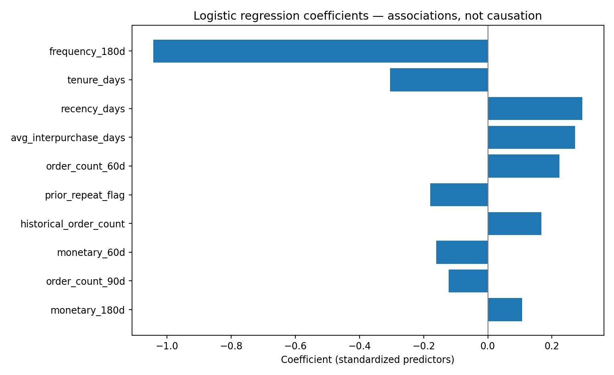

# Logistic Regression — Coefficient Interpretation

The model is a pipeline: median imputation → StandardScaler → LogisticRegression. Coefficients below correspond to a **one-standard-deviation change** in a predictor while holding the other modeled predictors fixed. Positive values are associated with **higher odds of no purchase in the next 90 days**. Correlated RFM windows make single-variable interpretations fragile. These are **associations, not causal effects**.

| Predictor | Standardized coefficient | Odds ratio (per 1 SD) | Direction |
|---|---:|---:|---|
| `frequency_180d` | -1.042 | 0.353 | Lower no-repeat odds |
| `tenure_days` | -0.305 | 0.737 | Lower no-repeat odds |
| `recency_days` | +0.295 | 1.343 | Higher no-repeat odds |
| `avg_interpurchase_days` | +0.272 | 1.312 | Higher no-repeat odds |
| `order_count_60d` | +0.223 | 1.250 | Higher no-repeat odds |
| `prior_repeat_flag` | -0.179 | 0.836 | Lower no-repeat odds |
| `historical_order_count` | +0.166 | 1.181 | Higher no-repeat odds |
| `monetary_60d` | -0.161 | 0.851 | Lower no-repeat odds |
| `order_count_90d` | -0.122 | 0.885 | Lower no-repeat odds |
| `monetary_180d` | +0.107 | 1.113 | Higher no-repeat odds |
| `avg_order_value_180d` | -0.055 | 0.946 | Lower no-repeat odds |
| `monetary_30d` | -0.035 | 0.966 | Lower no-repeat odds |
| `order_count_30d` | -0.016 | 0.984 | Lower no-repeat odds |
| `monetary_90d` | +0.015 | 1.015 | Higher no-repeat odds |



## Interpretation notes

- `frequency_180d` has the largest absolute coefficient and is negatively associated with non-repurchase risk, conditional on other features.
- `recency_days` has a positive coefficient: longer time since last purchase is associated with higher non-repurchase odds, conditional on other features.
- `tenure_days` has a negative coefficient, conditional on the rest of the model.
- `avg_interpurchase_days` has a positive coefficient, conditional on other features.
- Overlapping 30/60/90/180-day measures are correlated; coefficient signs and magnitudes may be unstable under alternative feature sets.
- The model artifact was trained with scikit-learn 1.9.1; this coefficient export was inspected under a different installed scikit-learn version and produced a version warning. The numerical values should be re-exported in the original training environment before being treated as a fully reproducible artifact.

## Reproduce in the training environment

```powershell
python scripts/export_model_coefficients.py --model output/phase3_models/selected_model.joblib --selection output/phase3_models/model_selection.json --output reports/logistic_regression_coefficients.csv
```
